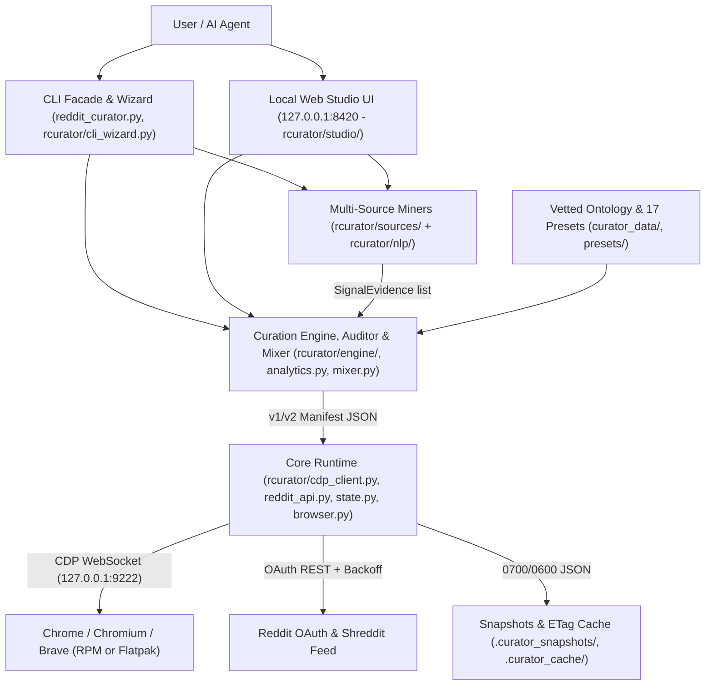
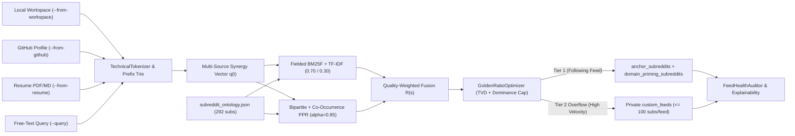

# `reddit-curator` v2.0 — System Architecture

`reddit-curator` v2.0 evolves a single-file Chrome DevTools Protocol (CDP) script into a modular, zero-extra-dependency Python package (`rcurator/`) engineered for Fedora Linux / PEP 668 environments (`Python 3.10+` stdlib + `requests` + `websockets`). It operates **100% locally and deterministically** without external AI/LLM APIs or Reddit developer app credentials.

---

## 1. High-Level System Overview



---

## 2. Repository & Package Topology

```text
curator/
├── reddit_curator.py                 # Backward-compatible CLI entrypoint & offline/online orchestrator
├── LICENSE                           # MIT License
├── pyproject.toml                    # PEP 621 packaging + rcurator.studio static package-data
├── manifest.example.json             # Canonical v1 declarative manifest template
├── curator_data/
│   ├── subreddit_ontology.json       # 292 vetted subreddits, 17 domains, 1,415 graph edges
│   └── philosophy.json               # Reverse Passive Marketing thesis, global stats & 17 verified sources
├── presets/                          # 17 domain presets (100% manifest.example.json compatible)
│   ├── systems_engineering.json
│   ├── machine_learning.json
│   ├── cognitive_science.json
│   └── ... (14 additional domain presets)
├── rcurator/
│   ├── __init__.py                   # Package version (2.0.0) & metadata
│   ├── browser.py                    # Fedora/Linux RPM & Flatpak browser detector/launcher
│   ├── cdp_client.py                 # Correlated CDP WebSocket RPC & Shadow-DOM feed locker
│   ├── reddit_api.py                 # Pooled OAuth client, pagination, rate-limit backoff, delta sync
│   ├── state.py                      # Timestamped SnapshotManager, diff engine & rollback
│   ├── analytics.py                  # Diet Health Auditor (TVD, Shannon entropy, Gini, quality)
│   ├── mixer.py                      # Convex Preset Mixer
│   ├── cli_wizard.py                 # Guided interactive terminal workflow
│   ├── nlp/
│   │   └── tokenizer.py              # Symbol-preserving TechnicalTokenizer & Prefix Trie
│   ├── sources/
│   │   ├── types.py                  # SignalEvidence dataclass
│   │   ├── workspace.py              # Symlink-safe & secret-guarded repository scanner
│   │   ├── github.py                 # ETag-cached, 6-call-budget GitHub profile/repo miner
│   │   └── resume.py                 # 3-tier local PDF (pypdf / pdftotext / pure-Python zlib) parser
│   ├── engine/
│   │   ├── ontology.py               # OntologyRepository & legacy manifest normalizer
│   │   ├── lexical.py                # Fielded BM25F + Sublinear TF-IDF scorer
│   │   ├── graph.py                  # Bipartite Concept-Subreddit + Co-occurrence PPR
│   │   ├── optimizer.py              # Velocity-weighted Golden Ratio constrained optimizer
│   │   ├── explain.py                # Per-subreddit provenance & math explainability builder
│   │   └── pipeline.py               # AutoPresetGenerator end-to-end orchestration
│   └── studio/
│       ├── server.py                 # ThreadingHTTPServer (127.0.0.1, CSRF, Host/Origin, traversal guards)
│       └── static/                   # Zero-build dark riced dashboard (index.html, styles.css, app.js)
├── tests/                            # Stdlib unittest.TestCase suites (pytest-compatible)
│   ├── test_core_runtime.py
│   ├── test_nlp_miners.py
│   ├── test_curation_engine.py
│   ├── test_web_studio.py
│   └── test_cli_integration.py
├── ALGORITHMS.md                     # Formal IR, graph, optimization & audit math
├── ARCHITECTURE.md                   # System architecture & security specifications
├── TECHNIQUE.md                      # Cognitive psychology foundations
└── README.md                         # Quickstart, preset catalog & CLI reference
```

---

## 3. Deterministic Curation & Optimization Dataflow



---

## 4. Core Runtime & Browser Synchronization Architecture

### 4.1 CDP WebSocket JSON-RPC & Session Flow

```mermaid
sequenceDiagram
    participant C as "reddit_curator / CDPClient"
    participant B as "BrowserLauncher (RPM/Flatpak)"
    participant W as "Chrome CDP (127.0.0.1:9222)"
    participant R as "Reddit OAuth API"

    C->>B: "launch(port=9222) if /json/list unreachable"
    B-->>C: "Detached process + /json/version ready"
    C->>W: "HTTP GET /json/list (loopback validated)"
    W-->>C: "Target tab URL (reddit.com hostname check)"
    C->>W: "WS connect (origin=None) + Page.reload (id=1)"
    loop "Poll every 400ms (max 10s)"
        C->>W: "Runtime.evaluate (readyState + localStorage token)"
        W-->>C: "Ignore async events; match msg.id == cmd_id"
    end
    C->>R: "GET /api/v1/me?raw_json=1 (Bearer token)"
    R-->>C: "Verified username"
    C->>R: "Paginated /subreddits/mine/subscriber + /api/multi/mine"
    C->>C: "SnapshotManager.create_snapshot() (.curator_snapshots/)"
    C->>R: "Delta subscribe + opt-in prune + PUT /api/multi/..."
    C->>W: "Page.navigate(?feed=following) + Shadow-DOM walker"
```

### 4.2 Hardening Details in `rcurator/cdp_client.py`

* **RPC Frame Correlation:** Uses a monotonic `itertools.count(1)` `cmd_id` inside an async context manager `CDPClient`. `send(method, params, timeout=15.0)` loops over `asyncio.wait_for(ws.recv(), timeout=remaining)`, discarding unsolicited CDP event frames (`"method"` present or `"id" != cmd_id`) and raising `CDPError` on `"error"` payloads.
* **WebSocket Origin & Loopback SSRF Guards:** Connects via `websockets.connect(ws_url, origin=None, max_size=16_777_216, open_timeout=5.0, close_timeout=2.0)` to satisfy `websockets 15.x`. Rejects non-`ws` schemes or non-loopback hosts (`127.0.0.1`, `localhost`, `::1`).
* **Tab Spoofing Guard & Fallback Token:** Validates target tab URLs via `urllib.parse.urlparse(url)` (`scheme in ("http", "https")` and `hostname == "reddit.com" or hostname.endswith(".reddit.com")`). If absent, creates `https://www.reddit.com/` via `Target.createTarget`. Falls back to CDP `Network.getCookies` (`token_v2`) if `localStorage["chat:access-token"]` is absent.
* **Resilient Shreddit Following Feed Lock:** Navigates to `https://www.reddit.com/?feed=following`, awaits document completion in the new context, and runs an open-Shadow-DOM recursive walker targeting `#feed-tab-2`, `a[href*="feed=following"]`, or `[role="tab"]` / `faceplate-tab` labeled `"Following"`.

### 4.3 Pooled Reddit OAuth Client (`rcurator/reddit_api.py`)

* **Session & Rate-Limit Backoff:** Uses `requests.Session` with `HTTPAdapter(pool_connections=10, pool_maxsize=10)`, appends `raw_json=1` on all requests, proactively throttles when `x-ratelimit-remaining < 2.0` using `x-ratelimit-reset`, and retries `429`/`500`/`502`/`503`/`504` up to $4$ times with jittered exponential backoff $\min(30, 1.0 \cdot 2^k) \cdot U(0.5, 1.0)$ honoring `Retry-After`.
* **Complete Cursor Pagination:** `fetch_all_subscriptions()` loops `GET /subreddits/mine/subscriber?limit=100&raw_json=1&after=<cursor>` until `after is None`, guarded by `seen_cursors` and `max_pages=50` ($5{,}000$ subreddits). Also queries `GET /api/multi/mine?raw_json=1`.
* **Anchor + Priming Delta Sync & Safe Pruning:** Subscribes to **both** `anchor_subreddits` and `domain_priming_subreddits`, skipping already-subscribed communities via case-insensitive set diff. Unsubscribing unmanaged subreddits is strictly opt-in (`--prune`, with `--keep <csv>` allowlist). Pre-mutation snapshots (`SnapshotManager.create_snapshot()`) are recorded automatically before **every** non-dry-run sync (`RedditCurator.run()`, `DefaultStudioBackend.sync_manifest()`, and `cli_wizard`).
* **Custom Feed Validation & Splitting:** Validates `feed_name` against `^[a-z0-9_]{1,50}$` and automatically partitions feeds exceeding Reddit's $100$-subreddit multireddit cap into `<feed_name>`, `<feed_name>_2`, etc.

### 4.4 Fedora / Linux Multi-Browser Launcher (`rcurator/browser.py`)

* Detects native RPM binaries (`google-chrome`, `google-chrome-stable`, `chromium`, `chromium-browser`, `brave-browser`) and Flatpak applications via `flatpak info` (`com.google.Chrome`, `com.brave.Browser`, `org.chromium.Chromium`).
* Launches detached processes bound to `--remote-debugging-address=127.0.0.1`, `--remote-debugging-port={port}`, `--remote-allow-origins=*` (safe because `--remote-debugging-address=127.0.0.1` binds strictly to loopback and `CDPClient` enforces loopback WebSocket URLs), `0700` `--user-data-dir` (`~/.config/reddit-curator/chrome-profile`), and `--ozone-platform-hint=auto` when `WAYLAND_DISPLAY` is active.
* For Flatpak browsers, passes `--filesystem=<resolved_user_data_dir>:create` so the sandbox can persist session cookies cleanly.

### 4.5 Snapshot, Diff & Rollback (`rcurator/state.py`)

* Writes pre-mutation snapshots into `.curator_snapshots/` (`0700` directory, `0600` files named `snapshot_<UTC_YYYYMMDDTHHMMSSffffffZ>_<user>.json`) capturing live subscriptions, `/api/multi/mine` custom feeds, and manifest metadata.
* `compute_diff()` previews additions, removals (only under `--prune`), and per-feed changes (`create` / `update` / `unchanged`).
* `rollback(snapshot_id | "latest")` restores exact subscription and custom-feed state with `--dry-run` preview support.

---

## 5. Local Web Studio & Security Model (`rcurator/studio/`)

Served via stdlib `http.server.ThreadingHTTPServer` bound strictly to `127.0.0.1` (default port `8420`) with a dark, terminal-inspired interface (`index.html`, `styles.css`, `app.js`):

| Threat Vector | Mitigation Implemented in `rcurator/studio/` |
| :--- | :--- |
| **Remote Network Exposure** | Socket bound strictly to loopback `127.0.0.1` (never `0.0.0.0`). |
| **DNS Rebinding** | Rejects requests (`403`) whose `Host` header is not `127.0.0.1:<port>` / `localhost:<port>` or whose `Origin` is external. |
| **CSRF on Mutating Routes** | Per-boot `secrets.token_urlsafe(24)` injected into `GET /` and required as `X-Curator-Token` on every `POST` route. |
| **Path Traversal** | Preset (`GET /api/presets/<name>`) and snapshot lookups enforce `Path.resolve().is_relative_to(...)` against their root directories. |
| **Sensitive Directory Scanning** | Blocks `/etc`, `/proc`, `/sys`, `/dev`, `/run`, `/root`, `/var`, `/boot`, and `$HOME` sensitive paths (`~/.ssh`, `~/.gnupg`, `~/.aws`, `~/.kube`, `~/.config/gcloud`, `~/.mozilla`, `~/.config/google-chrome`, `~/.config/chromium`, `~/.config/BraveSoftware`, `~/.config/reddit-curator`, `~/.local/share/keyrings`, `~/.password-store`). |
| **Upload Exhaustion & Disk Leaks** | Resume uploads (`POST /api/upload-resume`) are parsed strictly in memory with a $15\text{ MB}$ (`413`) cap; `cookies.json` and OAuth `access_token`s are never served. |
| **DOM XSS** | `app.js` constructs dynamic elements via `document.createElement`, `textContent`, `setAttribute`, and `createElementNS` — zero `innerHTML` with untrusted API or manifest strings. |

### Studio REST API Surface

* `GET /`, `GET /static/<asset>`
* `GET /api/status`, `GET /api/about` (serves `curator_data/philosophy.json` + live counts), `GET /api/presets`, `GET /api/presets/<name>`, `GET /api/snapshots`
* `POST /api/generate`, `POST /api/upload-resume`, `POST /api/import-manifest` (validates and normalizes custom JSON preset/manifest uploads), `POST /api/mix`, `POST /api/audit`, `POST /api/diff`, `POST /api/sync` (supports offline dry-run preview when CDP is closed), `POST /api/rollback`, `POST /api/launch-browser`

---

## 6. Backward Compatibility & Legacy Manifest Normalization

`rcurator/engine/ontology.py` provides `normalize_manifest()` so v1 presets (`manifest.example.json`, `presets/*.json`), legacy local manifests (`curation_manifest.json`), and v2 auto-generated manifests work interchangeably:

* Maps legacy `tier1_systems_subreddits` $\to$ `domain_priming_subreddits` and `metadata.cognitive_distribution` $\to$ `golden_ratio_distribution`.
* Normalizes legacy category `"high_signal_systems_priming"` $\to$ `"domain_priming"`.
* Resolves case-insensitive subreddit names against `curator_data/subreddit_ontology.json` canonical casing (e.g., `"askscience"` $\to$ `"AskScience"`).
* Attaches optional v2 `curation_provenance` (`algorithm`, `sources_used`, `top_extracted_terms`, `achieved_velocity_distribution_pct`, `diet_health`, `explanations`) without breaking v1 consumers.
