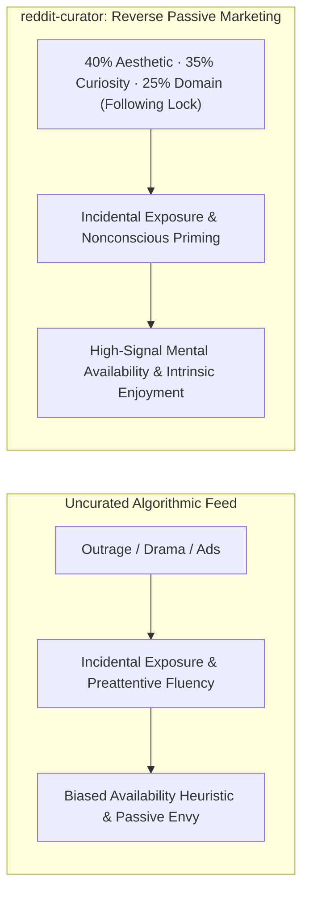

# Reverse Passive Marketing & Controlled Engagement: Cognitive Feed Curation Methodology

> **Core Thesis:** Modern social feeds operate as continuous, low-friction **passive marketing engines** that shape subconscious preference, mental availability, and habit loops outside focal awareness. Rather than relying on brittle digital abstinence or willpower-depleting bans, `reddit-curator` inverts that mechanism inward—turning ambient leisure scrolling into an intentional **Reverse Passive Marketing** and **Controlled Engagement** architecture grounded in cognitive, consumer, and media psychology.

---

## 1. Executive Concept: Why Architecture Beats Willpower

Deliberate, effortful study ("System 2" analytical processing) rapidly fatigues executive attention. By contrast, everyday digital breaks—opening a feed between builds, lectures, or commutes—run on low-friction perceptual habits. At global scale, this ambient channel is massive: DataReportal's *Digital 2025: Global Overview Report* documents **5.24 billion** active social media user identities (**63.9%** of the global population; methodological note: representing active user identities/accounts rather than strictly unique individuals) alongside **5.56 billion** internet users (**67.9%**), with internet users aged 16+ spending an average of **2 hours 21 minutes per day** across **6.8 social platforms per month** (Kemp, 2025). In the United States, **84%** of adults use YouTube and **26%** use Reddit, making interest-organized feeds a durable part of everyday technical and cultural media consumption (Gottfried & Park, 2025).

Most productivity advice frames that daily habit as a binary moral choice: either surrender to an uncurated algorithmic stream or enforce total prohibition via app blockers and "digital detoxes." Peer-reviewed behavioral science shows why both extremes fail—and points toward a third path:

1. **Reverse Passive Marketing:** Repurpose the same **mere exposure**, **preattentive fluency**, and **incidental exposure** mechanisms used in Below-The-Line (BTL) and ambient brand advertising so your own feed primes domain vocabulary, systems trade-offs, and scientific curiosity instead of outrage or impulse consumption.
2. **Controlled Engagement & Awareness Over Prohibition:** Replace fragile abstinence rules with structural feed engineering—locking Reddit to the deterministic **Following** timeline, balancing post velocity across a **40 / 35 / 25 Golden Ratio**, interleaving distinct intellectual contexts, and isolating high-volume communities into on-demand **Tier-2 Custom Feeds**.



---

## 2. Reverse Passive Marketing: Theoretical Foundations

### 2.1 Mere Exposure & Preattentive Fluency (Zajonc, 1968; Bornstein, 1989; Janiszewski, 1993)
Commercial advertisers invest heavily in ambient impressions because persuasion does not require attentive reading or explicit memory:

* **Attitudinal Mere Exposure:** Zajonc (1968) demonstrated in a landmark monograph that simple repeated perception of a stimulus—with zero reinforcement, reward, or conscious argument—reliably increases positive affect and familiarity toward it.
* **Subconscious Strength Without Recognition:** Bornstein's (1989) meta-analysis of **208 independent experiments** established a robust exposure–affect correlation (**mean $r = .26$**) and showed that mere exposure effects are often **stronger under brief, degraded, or incidental exposure without conscious recognition** than when subjects consciously monitor the stimulus.
* **Preattentive Processing Outside Focal Attention:** Janiszewski (1993) demonstrated that incidental exposure to brand names and visual stimuli placed outside focal reading attention enhances preattentive processing fluency and preference even when participants cannot recall seeing the stimulus.

### 2.2 Incidental Ad Exposure & Consideration Sets (Shapiro, MacInnis, & Heckler, 1997)
In a pivotal consumer-research experiment, Shapiro, MacInnis, and Heckler (1997) showed that incidental exposure to advertisements appearing peripherally while readers focused on primary editorial content significantly increased the probability that the advertised item entered the consumer's **consideration set**—across both memory-based and stimulus-based decisions—**despite zero explicit recognition memory of the ad**.

**The `reddit-curator` Inversion:** Every post title, architecture diagram, failure postmortem, and craftsmanship showcase skimmed on a home feed is an incidental exposure event. When a feed is uncurated, commercial sponsors and engagement-maximizing algorithms decide what enters your mental consideration set. `reddit-curator` flips that loop inward: you curate the exact conceptual landscape (systems internals, epistemology, clean design) that accumulates preattentive fluency during casual breaks.

### 2.3 Why People Deny Feed Influence: The Third-Person Effect (Davison, 1983; Sun, Pan, & Shen, 2008)
If ambient feeds shape cognition so reliably, why do intelligent users routinely dismiss feed hygiene as trivial?

* **The Perceptual Blind Spot:** Davison (1983) identified the **third-person effect**—the systematic tendency for individuals to overestimate the persuasive impact of mass media and advertising on *other people* while underestimating or denying its influence on *themselves* ("algorithms and ads don't affect me").
* **Meta-Analytic Confirmation:** Sun, Pan, and Shen's (2008) meta-analysis across **106 studies** (**372 effect sizes** from 60 papers) confirmed a large, persistent self–other perceptual gap, strongest when the presumed influence is perceived as undesirable (**$d = 0.86$**) or ambiguous (**$d = 0.65$**).

Recognizing the third-person effect is the prerequisite for **awareness**: no user is immune to ambient environmental cues, so engineering the cue stream is far more reliable than assuming personal immunity.

### 2.4 The Availability Heuristic & Nonconscious Priming (Tversky & Kahneman, 1973; Tulving & Schacter, 1990)
* **The Availability Heuristic (Tversky & Kahneman, 1973):** People judge frequency, probability, and plausible solutions by the ease with which examples are retrieved from memory. If an ambient feed consistently presents query execution plans, lock-free concurrency bugs, statistical fallacies, or clean visual systems, those concrete patterns become immediately retrievable during design reviews, debugging, and technical interviews.
* **Nonconscious Priming Memory (Tulving & Schacter, 1990):** In *Science*, Tulving and Schacter established perceptual and conceptual priming as a distinct nonconscious human memory system in which prior exposure facilitates subsequent processing speed and conceptual activation independently of explicit episodic recall.

---

## 3. Controlled Engagement & Awareness Over Prohibition

### 3.1 Why Hard Bans & Digital Detoxes Backfire or Underperform
Blocking social platforms completely feels decisive, yet empirical psychology repeatedly shows why rigid prohibition fails to deliver durable well-being or cognitive gains:

* **Psychological Reactance (Brehm, 1966; Rosenberg & Siegel, 2018):** When an external rule or self-imposed blocker eliminates a valued behavioral freedom, it triggers **psychological reactance**—an aversive motivational state that amplifies desire for the forbidden activity and fuels boomerang/rebound bingeing. Rosenberg and Siegel's (2018) 50-year review confirms reactance as a robust driver of counter-intentional relapse across behavioral interventions.
* **Ironic Process Rebound (Wegner, 1994):** Wegner's theory of ironic mental control shows that active suppression ("do not open social feeds") installs an automatic ironic monitoring process that continuously scans memory for the forbidden cue, producing **hyperaccessibility and post-suppression rebound** whenever stress or cognitive load rises.
* **Mixed and Null Clinical Evidence for Abstinence Detoxes:**
  * **PRISMA Systematic Review (Radtke, Apel, Schenkel, Keller, & von Lindern, 2022):** Across **21 studies ($N = 3{,}625$**, including 12 RCTs), digital detox and abstinence interventions produced **highly inconsistent, predominantly mixed or null effects** on well-being, self-control, and performance, with some participants reporting heightened anxiety or Fear of Missing Out (FoMO).
  * **Four-Week Randomized Diary Experiment (Hall, Xing, Ross, & Johnson, 2021):** Assigning **$N = 130$** participants to 0, 1, 2, 3, or 4 weeks of social media abstinence yielded **no significant main effect** of abstinence or duration on daily well-being, loneliness, or quality of day.
  * **Three Preregistered Field Experiments (Przybylski, Nguyen, Law, & Weinstein, 2021):** Short social media breaks produced **no measurable improvements** in positive affect or self-esteem and lowered perceived social relatedness when abrupt abstinence lacked replacement structure.
* **Passive vs. Intentional Architecture (Verduyn et al., 2017):** Verduyn, Ybarra, Résibois, Jonides, and Kross (2017) resolved the apparent paradox in a critical review: **passive consumption of uncurated feeds** undermines subjective well-being (largely via upward social comparison and low-agency scrolling), whereas **active, intentional, interest-aligned engagement** supports knowledge exchange, belonging, and well-being.

The takeaway is clear: **feed architecture and intentionality—not raw abstinence—govern outcomes.**

### 3.2 Context Interleaving & the 40 / 35 / 25 Golden Ratio (Kornell & Bjork, 2008)
Even a well-intentioned technical feed collapses if it turns every break into monotonous homework:

* **Empirical Grounding in Context Interleaving:** Kornell and Bjork (2008) demonstrated that **interleaving** exemplars across distinct categories produces markedly superior inductive learning and transfer compared to massed/blocked single-topic study—**61% vs. 35%** correct generalization in Experiment 1A ($N = 120$, with **78%** of learners outperforming their own massed score) and **59% vs. 36%** in between-subjects Experiment 1B ($N = 72$)—despite a pervasive metacognitive illusion in which **78%** of participants mistakenly believed blocked exposure helped them more.

To capture interleaving benefits while preventing "feed aversion" (abandoning a dry feed for cheap distractions), `reddit-curator` enforces the velocity-weighted **40 / 35 / 25 Golden Ratio** across three cognitive pillars:

```
┌────────────────────────────────────────────────────────────────────────────────────────┐
│                        THE GOLDEN RATIO FEED DISTRIBUTION                              │
│                                                                                        │
│   ┌──────────────────────────┬──────────────────────────┬───────────────────────────┐  │
│   │   Aesthetic / Leisure    │   Cognitive Curiosity    │   Target Domain Priming   │  │
│   │   40% Feed Impressions   │   35% Feed Impressions   │   25% Feed Impressions    │  │
│   │   (Anchor Pleasure)      │   (Lateral Synthesis)    │   (High Signal Density)   │  │
│   │   [Craft & Visual Flow]  │   [Science & Models]     │   [Core Technical Edge]   │  │
│   └──────────────────────────┴──────────────────────────┴───────────────────────────┘  │
└────────────────────────────────────────────────────────────────────────────────────────┘
```

1. **40% Aesthetic & Leisure (`aesthetic_leisure` — The Intrinsic Hook):** High-craft visual and hobbyist communities (e.g., desktop ricing, industrial design, photography, woodworking). Keeps opening the feed genuinely rewarding so controlled engagement remains sustainable without reactance.
2. **35% Cognitive Curiosity (`cognitive_curiosity` — Lateral Thinking):** Strictly moderated, multidisciplinary inquiry communities (e.g., cognitive science, history, philosophy of science, economics, scientific Q&A). Builds analytical patience and cross-domain analogies.
3. **25% Target Domain Priming (`domain_priming` — The Professional Edge):** Focused technical communities aligned with your active codebase, resume, or study goals (e.g., database internals, compilers, kernel/eBPF, ML inference).

### 3.3 Four Architectural Controls Implemented in `reddit-curator`
1. **Deterministic `Following` Feed Lock:** Forces `https://www.reddit.com/?feed=following` via Chrome DevTools Protocol (CDP) and open-Shadow-DOM tab activation (`#feed-tab-2` / `feed=following`), stripping out algorithmic "Home" recommendations and viral injection.
2. **Velocity-Weighted Impression Optimization:** Rather than counting subreddit names naively (where one 500-post/day megasub drowns out ten niche 3-post/day engineering subs), `GoldenRatioOptimizer` balances *expected daily impression share* against the 40/35/25 target and enforces a strict **$\le 50\%$ single-subreddit dominance cap** (see [`ALGORITHMS.md`](ALGORITHMS.md)).
3. **Two-Tier Feed Separation (Tier 1 vs. Tier 2 Custom Feeds):**
   * **Tier 1 (Main Following Feed):** Houses balanced `anchor_subreddits` (`aesthetic_leisure` + `cognitive_curiosity`) and lower-volume, high-signal `domain_priming_subreddits`.
   * **Tier 2 (Private Custom Feeds / Multireddits):** Automatically routes ultra-high-velocity technical hubs into private `/user/{username}/m/{feed_name}` feeds (partitioned at Reddit's 100-subreddit limit) for intentional deep-dive sprints without flooding casual breaks.
4. **Reversible, Transparent Hygiene:** Every live sync captures a pre-mutation backup in `.curator_snapshots/`, supports `--diff` and `--audit` / `--audit-live` health scoring, keeps unmanaged pruning strictly opt-in (`--prune` + `--keep`), and supports one-command `--rollback`.

---

## 4. Verified Peer-Reviewed References & Global Statistics

All 17 sources below have been verified for exact authorship, publication year, venue, empirical figures, and persistent URLs/DOIs.

### 4.1 Global Social Media Scale & Exposure
1. **Kemp, S. (2025).** *Digital 2025: Global Overview Report*. DataReportal (in partnership with We Are Social & Meltwater). URL: [https://datareportal.com/reports/digital-2025-global-overview-report](https://datareportal.com/reports/digital-2025-global-overview-report) — Reports **5.24 billion** active social media user identities worldwide (**63.9%** of total global population; measuring active user identities rather than strictly unique individuals), **5.56 billion** global internet users (**67.9%**), and an average of **2 hours 21 minutes per day** spent on social media across **6.8 platforms per month** among internet users aged 16+.
2. **Gottfried, J., & Park, E. (2025).** *Americans' Social Media Use 2025*. Pew Research Center. URL: [https://www.pewresearch.org/internet/fact-sheet/social-media/](https://www.pewresearch.org/internet/fact-sheet/social-media/) — Documents **84%** U.S. adult usage of YouTube and **26%** U.S. adult usage of Reddit.

### 4.2 Passive Marketing, Mere Exposure & Incidental Conditioning
3. **Zajonc, R. B. (1968).** Attitudinal effects of mere exposure. *Journal of Personality and Social Psychology*, *9*(2, Pt. 2), 1–27. DOI: [https://doi.org/10.1037/h0025848](https://doi.org/10.1037/h0025848)
4. **Bornstein, R. F. (1989).** Exposure and affect: Overview and meta-analysis of research, 1968–1987. *Psychological Bulletin*, *106*(2), 265–289. DOI: [https://doi.org/10.1037/0033-2909.106.2.265](https://doi.org/10.1037/0033-2909.106.2.265) — Meta-analysis of **208 independent experiments** (**mean $r = .26$**), demonstrating stronger mere-exposure effects without conscious recognition.
5. **Janiszewski, C. (1993).** Preattentive mere exposure effects. *Journal of Consumer Research*, *20*(3), 376–392. DOI: [https://doi.org/10.1086/209356](https://doi.org/10.1086/209356)
6. **Shapiro, S., MacInnis, D. J., & Heckler, S. E. (1997).** The effects of incidental ad exposure on the formation of consideration sets. *Journal of Consumer Research*, *24*(1), 94–104. DOI: [https://doi.org/10.1086/209496](https://doi.org/10.1086/209496)

### 4.3 Third-Person Blind Spot & Cognitive Priming
7. **Davison, W. P. (1983).** The third-person effect in communication. *Public Opinion Quarterly*, *47*(1), 1–15. DOI: [https://doi.org/10.1086/268763](https://doi.org/10.1086/268763)
8. **Sun, Y., Pan, Z., & Shen, L. (2008).** Understanding the third-person perception: Evidence from a meta-analysis. *Journal of Communication*, *58*(2), 280–300. DOI: [https://doi.org/10.1111/j.1460-2466.2008.00385.x](https://doi.org/10.1111/j.1460-2466.2008.00385.x) — Meta-analysis of **106 studies** (**372 effect sizes** from 60 papers); **$d = 0.86$** for undesirable influence and **$d = 0.65$** for ambiguous influence.
9. **Tversky, A., & Kahneman, D. (1973).** Availability: A heuristic for judging frequency and probability. *Cognitive Psychology*, *5*(2), 207–232. DOI: [https://doi.org/10.1016/0010-0285(73)90033-9](https://doi.org/10.1016/0010-0285(73)90033-9)
10. **Tulving, E., & Schacter, D. L. (1990).** Priming and human memory systems. *Science*, *247*(4940), 301–306. DOI: [https://doi.org/10.1126/science.2296719](https://doi.org/10.1126/science.2296719)

### 4.4 Controlled Engagement & Awareness Over Prohibition
11. **Rosenberg, B. D., & Siegel, J. T. (2018)** *(reviewing **Brehm, J. W., 1966**, A Theory of Psychological Reactance, New York: Academic Press)*. A 50-year review of psychological reactance theory: Do not read this article. *Motivation Science*, *4*(4), 281–300. DOI: [https://doi.org/10.1037/mot0000091](https://doi.org/10.1037/mot0000091)
12. **Wegner, D. M. (1994).** Ironic processes of mental control. *Psychological Review*, *101*(1), 34–52. DOI: [https://doi.org/10.1037/0033-295X.101.1.34](https://doi.org/10.1037/0033-295X.101.1.34)
13. **Radtke, T., Apel, T., Schenkel, K., Keller, J., & von Lindern, E. (2022).** Digital detox: An effective solution in the smartphone era? A systematic literature review. *Mobile Media & Communication*, *10*(2), 190–215. DOI: [https://doi.org/10.1177/20501579211028647](https://doi.org/10.1177/20501579211028647) — PRISMA systematic review of **21 studies ($N = 3{,}625$**, including 12 RCTs).
14. **Hall, J. A., Xing, C., Ross, E. M., & Johnson, R. M. (2021).** Experimentally manipulating social media abstinence: Results of a four-week diary study. *Media Psychology*, *24*(2), 259–275. DOI: [https://doi.org/10.1080/15213269.2019.1688171](https://doi.org/10.1080/15213269.2019.1688171) — Randomized 4-week diary experiment (**$N = 130$**).
15. **Przybylski, A. K., Nguyen, T. V. T., Law, W., & Weinstein, N. (2021).** Does taking a short break from social media have a positive effect on well-being? Evidence from three preregistered field experiments. *Journal of Technology in Behavioral Science*, *6*(3), 507–514. DOI: [https://doi.org/10.1007/s41347-020-00189-w](https://doi.org/10.1007/s41347-020-00189-w)
16. **Verduyn, P., Ybarra, O., Résibois, M., Jonides, J., & Kross, E. (2017).** Do social network sites enhance or undermine subjective well-being? A critical review. *Social Issues and Policy Review*, *11*(1), 274–302. DOI: [https://doi.org/10.1111/sipr.12033](https://doi.org/10.1111/sipr.12033)

### 4.5 Context Interleaving & Inductive Generalization
17. **Kornell, N., & Bjork, R. A. (2008).** Learning concepts and categories: Is spacing the "enemy of induction"? *Psychological Science*, *19*(6), 585–592. DOI: [https://doi.org/10.1111/j.1467-9280.2008.02127.x](https://doi.org/10.1111/j.1467-9280.2008.02127.x) — **61% vs. 35%** in Exp. 1A ($N = 120$, **78%** outperformed their own massed score); **59% vs. 36%** in Exp. 1B ($N = 72$); **78%** believed massing helped more.
